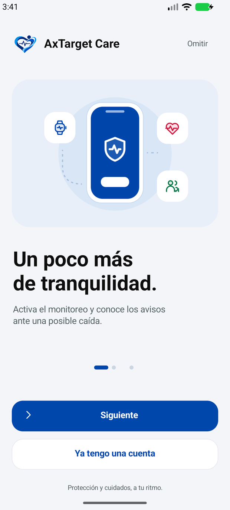
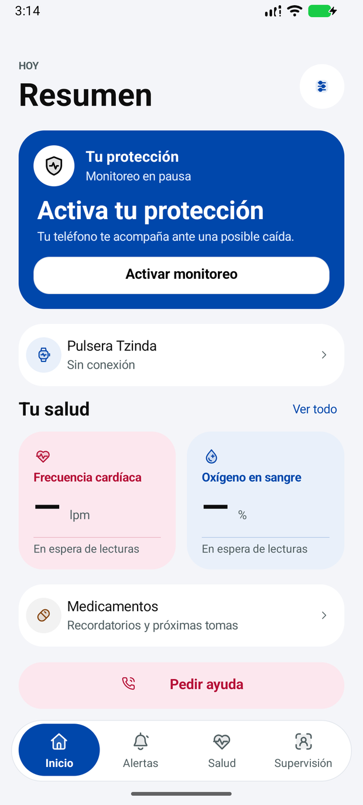
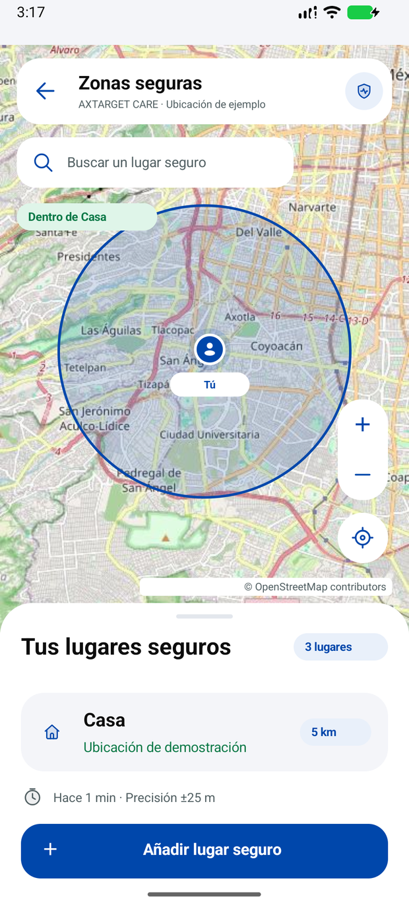

<p align="center">
  
</p>

<h1 align="center">AxTarget Care</h1>

<p align="center">Monitoreo de posibles caídas y coordinación del cuidado en Android.</p>

AxTarget Care ayuda a la persona protegida a avisar a sus contactos si necesita ayuda. También permite a un cuidador consultar los eventos, la ubicación y los datos de salud que la persona decida compartir.

## Capturas de la aplicación

<p align="center">
  
  
  
</p>

De izquierda a derecha, bienvenida, resumen y zonas seguras. Capturas de Android con datos de prueba.

## Modos de uso

| Modo | Qué permite hacer |
| --- | --- |
| **Persona protegida** | Activar el monitoreo, pedir ayuda, administrar contactos y zonas seguras, consultar lecturas de la pulsera y registrar medicamentos. |
| **Cuidador o familiar** | Vincularse por QR o código y consultar la información que autorice la persona vinculada. |
| **Cámara independiente** | Usar un teléfono como cámara de detección local y compartir los eventos autorizados con la persona vinculada. El video permanece en el dispositivo. |

## Funciones principales

- **Alertas de caída.** Ante una posible caída, una cuenta regresiva de 20 segundos permite cancelar el aviso. Si vence o se solicita ayuda, la app intenta contactar por SMS y llamada según los permisos, la SIM y la cobertura disponibles.
- **Ubicación y zonas seguras.** Al abrir el mapa, la app busca la ubicación del teléfono si cuenta con permiso. La cartografía es de OpenStreetMap y las rutas dentro de la app usan OSRM. Desde las indicaciones se puede abrir Google Maps para iniciar la navegación allí.
- **Pulsera y salud.** La app recibe lecturas válidas de pulso y SpO₂ de la pulsera Arduino UNO Q vinculada por Bluetooth LE. El nombre que anuncia la pulsera al emparejarse es `Tzinda`.
- **Medicamentos.** Escanea una caja o frasco para leer el medicamento. En una receta, revisa cada medicamento detectado con su dosis e indicaciones y consulta las notas generales por separado. La lectura en el teléfono está disponible sin conexión.
- **Primer ingreso.** La bienvenida y el tutorial se adaptan al modo seleccionado. Al iniciar sesión, Android solicita los permisos correspondientes a ese modo.

## Compilar y probar

La aplicación está escrita en Kotlin. El proyecto usa el SDK 36 para compilar y admite teléfonos con Android 7.0 (API 24) o posterior. Abre la raíz del repositorio en Android Studio o ejecuta el siguiente comando en Windows.

```powershell
.\gradlew.bat :app:assembleDebug
```

El APK de depuración queda en `app/build/outputs/apk/debug/app-debug.apk`. Este comando ejecuta las pruebas unitarias y compila una variante aislada de las cuentas remotas.

```powershell
.\gradlew.bat -PtzindaAudit=true :app:testDebugUnitTest :app:assembleDebug
```

### Configuración de Supabase

Para activar el inicio de sesión, la sincronización y los vínculos entre teléfonos, copia [`.env.example`](.env.example) a `.env.local` y configura `TZINDA_SUPABASE_URL`, `TZINDA_SUPABASE_PUBLISHABLE_KEY` y `TZINDA_SUPABASE_REDIRECT_URL`. La aplicación Android utiliza la clave publicable. Las claves privadas, incluida `service_role`, se configuran en el servidor. [Guía de Supabase](docs/supabase-backend.md) · [Migraciones](supabase/migrations)

**Continuar con Google** abre el navegador y regresa a AxTarget Care después de autenticar la cuenta. Desde **Ajustes → Cerrar sesión** puedes volver a la pantalla de acceso y entrar o crear una cuenta. [Configurar Google](docs/supabase-backend.md#inicio-de-sesión-con-google-en-android)

La lectura en la nube es opcional. La función autenticada `medication-label` usa NVIDIA Nemotron 3.5 Parse para la página de la receta y Super VL para organizar la lectura. Si la nube falla, la app vuelve a leer la imagen en el teléfono. [Configuración del OCR en la nube](docs/medication-label-proxy.md)

### Pulsera Arduino UNO Q

El repositorio incluye el firmware Bluetooth LE y una integración local de pruebas mediante Wi-Fi con HTTPS, huella del certificado y token. [Proyectos para Arduino App Lab](arduino/) · [Paquetes del proyecto](outputs/)

## Estado y alcance

La detección de caídas es experimental y puede omitir caídas o generar falsas alarmas. Ante una emergencia, utiliza los servicios de emergencia de tu localidad. La validación de SMS y llamadas, del vínculo entre teléfonos y de la pulsera requiere dispositivos físicos. [Resultados de auditorías anteriores](docs/auditoria/README.md)
