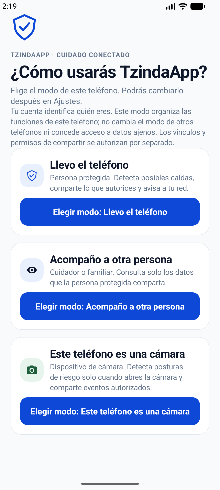
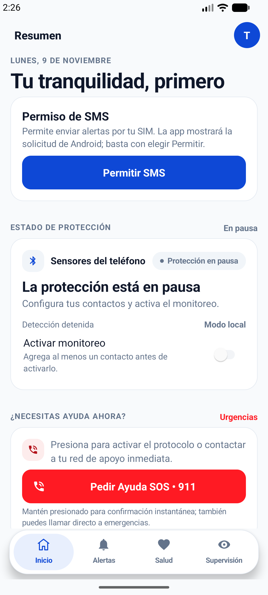
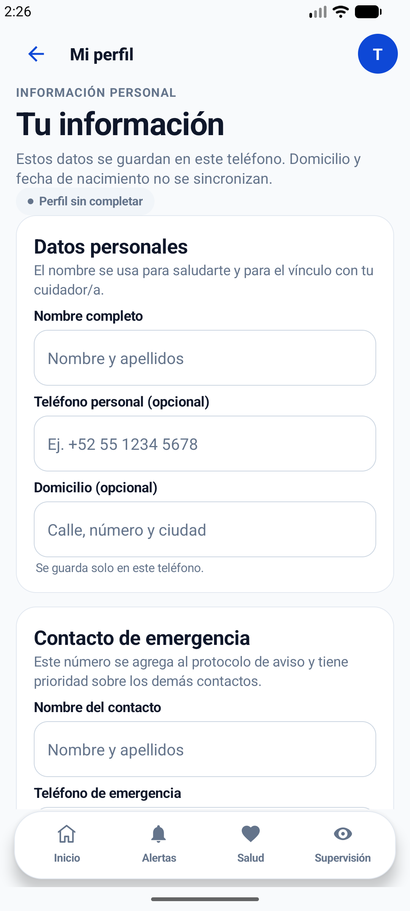
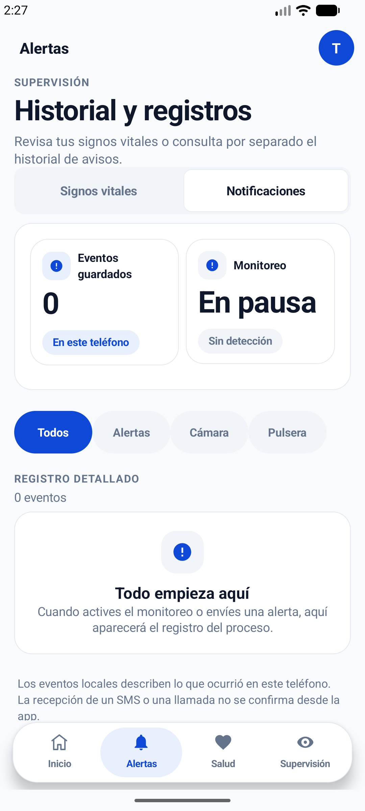
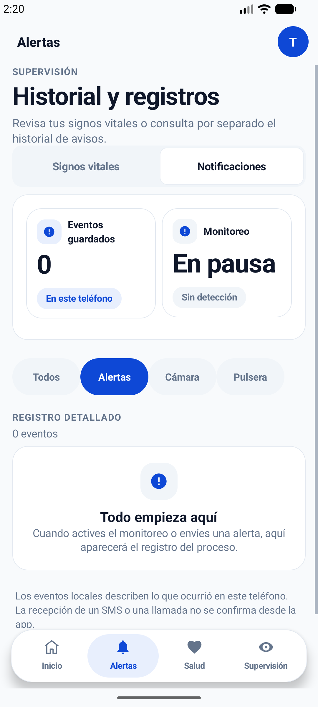
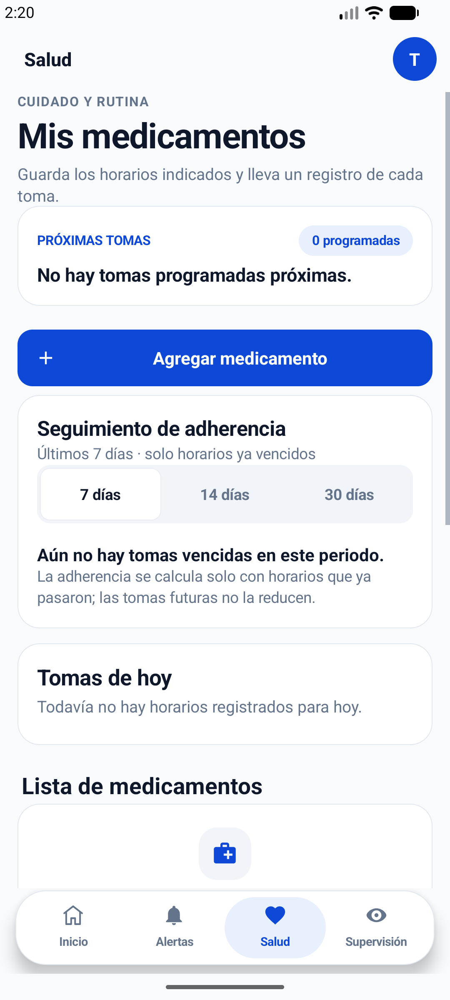
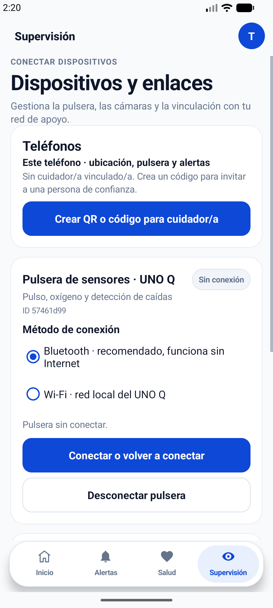

# Revisión visual de interfaz y navegación

Revisión manual en el AVD Medium_Phone_API_37.0, con el APK `com.guardian.tzindaapp.v2.audit` y una sesión local sin credenciales de servicios. Las capturas muestran el modo de persona protegida. No se inició monitoreo ni se activó SOS.

## Hallazgos y cambios

- La pestaña **Alertas** abría **Signos vitales** mientras el historial de avisos estaba en la segunda opción. Cambié la opción inicial y el fallback al restaurar el estado a **Notificaciones**. Los signos vitales siguen disponibles como opción explícita.
- Los tres botones de modo anunciaban el mismo nombre accesible. Ahora cada uno incluye el modo que selecciona.
- La pantalla de perfil repetía **Mi perfil** en la barra superior y en el título de contenido. El título principal ahora es **Tu información**.
- La pantalla de salud indica que no hay lecturas y que los medicamentos aún no están configurados. Supervisión indica que no hay equipos vinculados. Estos son estados vacíos observados; no se crearon lecturas, medicamentos ni vínculos durante la revisión.

## Capturas del flujo observado

1. Selección de modo: botones con etiquetas accesibles distintas.

   

2. Inicio de persona protegida; el control SOS se dejó intacto.

   

3. Perfil local, con título único y nota sobre datos que no se sincronizan.

   

4. Alertas abre Notificaciones; el historial vacío explica cuándo aparecerán registros.

   

5. Filtro de alertas seleccionado, sin registros de prueba.

   

6. Estado vacío de salud y medicamentos.

   

7. Supervisión sin dispositivos vinculados.

   

## Límites de esta revisión

La jerarquía de vistas y cuatro comportamientos tienen pruebas instrumentadas. Las imágenes no prueban compatibilidad con TalkBack, ampliación máxima de texto, teclado físico, permisos del fabricante, alertas reales ni aceptación en teléfonos físicos. No se recorrieron los modos cuidador y cámara mediante UI manual; el renderizado del enlace del cuidador tiene una prueba instrumentada independiente.
